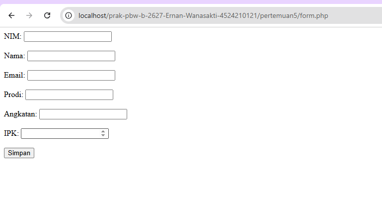
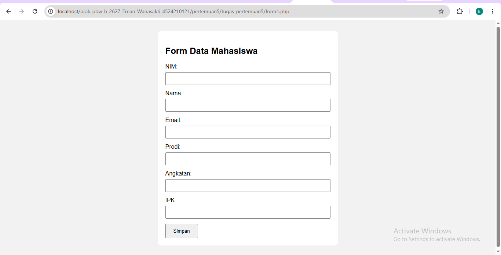
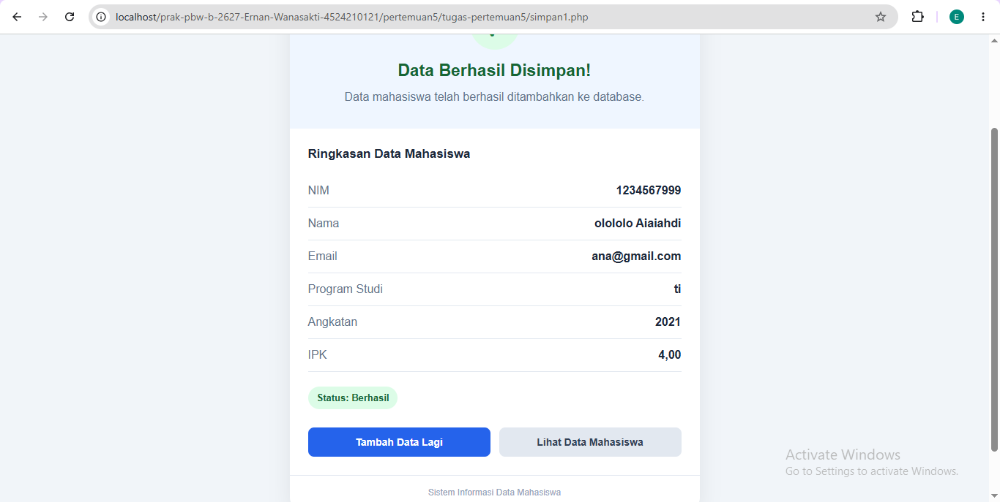
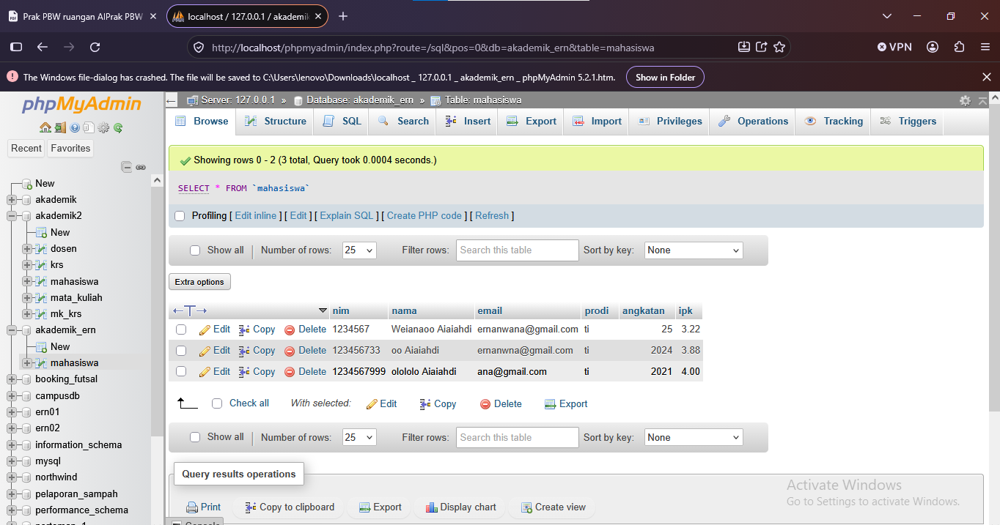

# LAPORAN TUGAS PERTEMUAN 5

## Praktikum Pemrograman Berbasis Web

**Nama:** Ernan Wanasakti  
**NIM:** 4524210121  
**Program Studi:** Teknik Informatika  
**Universitas:** Universitas Pancasila

---

## 1. Deskripsi Tugas

Pada tugas Pertemuan 5, dilakukan modifikasi program input data mahasiswa menggunakan PHP dan MySQL. Program ini terdiri dari empat file utama, yaitu `form1.php`, `koneksi1.php`, `data1.php`, dan `simpan1.php`.

Modifikasi dilakukan pada file `form1.php` dan `simpan1.php`. Perubahan mencakup perbaikan tampilan form, penambahan validasi input, penggunaan prepared statement untuk penyimpanan data, serta pembuatan halaman konfirmasi yang menampilkan ringkasan data mahasiswa setelah proses penyimpanan.

## 2. Struktur Folder

```text
tugas-pertemuan5/
├── form1.php
├── koneksi1.php
├── data1.php
├── simpan1.php
├── README.md
└── screenshot/
    ├── form-sebelum.png
    ├── form-sesudah.png
    ├── simpan-sesudah.png
    └── data-database.png
```

## 3. Modifikasi Program

### A. Modifikasi pada form1.php

Modifikasi yang dilakukan pada file `form1.php` meliputi:

1. Menambahkan judul Form Data Mahasiswa.
2. Menambahkan CSS agar tampilan form lebih rapi dan nyaman digunakan.
3. Menambahkan label pada setiap kolom input.
4. Menambahkan validasi NIM agar hanya menerima angka.
5. Membatasi nilai IPK dari 0 sampai 4 dengan ketelitian dua angka desimal.
6. Menambahkan batas panjang nama dan rentang tahun angkatan.
7. Mengarahkan pengiriman data ke file `simpan1.php`.

### B. Modifikasi pada simpan1.php

Modifikasi yang dilakukan pada file `simpan1.php` meliputi:

1. Memastikan data dikirim menggunakan metode POST.
2. Memvalidasi NIM, nama, email, program studi, angkatan, dan IPK.
3. Menggunakan prepared statement untuk menjalankan query penyimpanan data.
4. Membuat tampilan konfirmasi yang lebih menarik setelah data berhasil disimpan.
5. Menampilkan ringkasan data mahasiswa, meliputi NIM, nama, email, program studi, angkatan, dan IPK.
6. Menampilkan status keberhasilan atau kegagalan penyimpanan.
7. Menambahkan tombol untuk kembali ke form dan melihat data mahasiswa.

## 4. Lima Bagian Kode yang Penting

### 1. Form HTML pada form1.php

```html
<form action="simpan1.php" method="post"></form>
```

Kode tersebut digunakan untuk mengirimkan data yang dimasukkan pengguna ke file `simpan1.php` menggunakan metode POST. Data yang dikirim selanjutnya diproses untuk disimpan ke database.

### 2. Validasi IPK pada form1.php

```html
<input type="number" id="ipk" name="ipk" min="0" max="4" step="0.01" required />
```

Kode ini membatasi nilai IPK antara 0 sampai 4. Atribut `step="0.01"` memungkinkan pengguna memasukkan nilai dengan ketelitian dua angka desimal, sedangkan `required` memastikan kolom harus diisi.

### 3. Pemanggilan Koneksi Database

```php
include "koneksi1.php";
```

Kode ini digunakan untuk memanggil file `koneksi1.php` agar program dapat menggunakan koneksi database MySQL yang telah dibuat.

### 4. Prepared Statement pada simpan1.php

```php
$stmt = mysqli_prepare(
    $koneksi,
    "INSERT INTO mahasiswa
    (nim, nama, email, prodi, angkatan, ipk)
    VALUES (?, ?, ?, ?, ?, ?)"
);
```

Kode tersebut menyiapkan perintah SQL untuk menyimpan data mahasiswa. Tanda tanya berfungsi sebagai parameter yang akan diisi dengan data pengguna. Prepared statement membantu mengurangi risiko SQL injection.

### 5. Proses Penyimpanan Data

```php
$berhasil = mysqli_stmt_execute($stmt);
```

Kode ini menjalankan perintah SQL yang telah disiapkan. Hasil eksekusi disimpan ke variabel `$berhasil` untuk menentukan apakah program perlu menampilkan halaman konfirmasi keberhasilan atau pesan kegagalan.

Pada program yang telah dimodifikasi, halaman konfirmasi juga menampilkan ringkasan data mahasiswa dan tombol navigasi.

## 5. Dokumentasi Screenshot

### A. Form Sebelum Modifikasi

Screenshot ini menunjukkan tampilan form input mahasiswa sebelum dilakukan perubahan. Tampilan awal menggunakan struktur HTML sederhana.



### B. Form Sesudah Modifikasi

Screenshot ini menunjukkan tampilan form setelah ditambahkan CSS, label input, dan validasi pada beberapa kolom.



### C. Hasil Penyimpanan Data

Screenshot ini menunjukkan halaman konfirmasi setelah pengguna mengisi form pada `form1.php` dan menekan tombol Simpan Data. Halaman menampilkan pesan keberhasilan serta ringkasan data mahasiswa yang baru dimasukkan.



### D. Data Mahasiswa pada Database

Screenshot ini menunjukkan data mahasiswa yang telah berhasil disimpan dan ditampilkan pada tabel `mahasiswa` melalui phpMyAdmin.



## 6. Error atau Kendala yang Ditemui

### Validasi Input Menolak Data yang Tidak Sesuai

**Kendala:**

Form tidak menerima nilai IPK yang berada di luar rentang 0 sampai 4 atau input NIM yang mengandung karakter selain angka.

**Penyebab:**

Program memiliki aturan validasi untuk menjaga agar data mahasiswa yang dimasukkan sesuai dengan ketentuan yang telah ditetapkan.

**Langkah Penanganan:**

Input diperiksa kembali dan disesuaikan dengan aturan form. NIM diisi menggunakan angka, sedangkan IPK diisi dalam rentang 0 sampai 4. Validasi juga diterapkan pada sisi PHP agar data yang dikirim tetap diperiksa sebelum disimpan ke database.

## 7. Kesimpulan

Melalui tugas Pertemuan 5, program input data mahasiswa berhasil dikembangkan dengan memperbaiki tampilan form, menambahkan validasi input, dan menggunakan prepared statement dalam proses penyimpanan data.

Selain itu, halaman hasil penyimpanan dibuat lebih informatif dengan menampilkan status penyimpanan dan ringkasan data mahasiswa. Pengujian melalui localhost dan phpMyAdmin digunakan untuk memeriksa proses input serta memastikan data yang dimasukkan tersimpan di database.