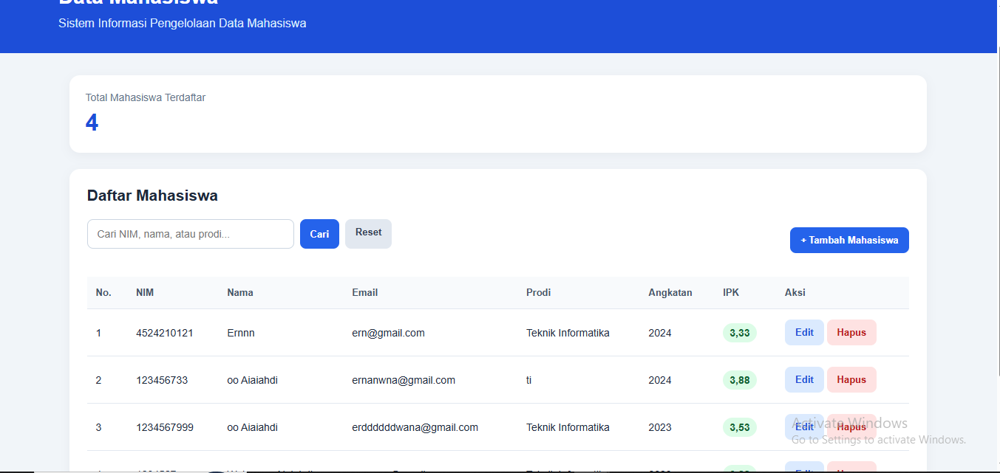
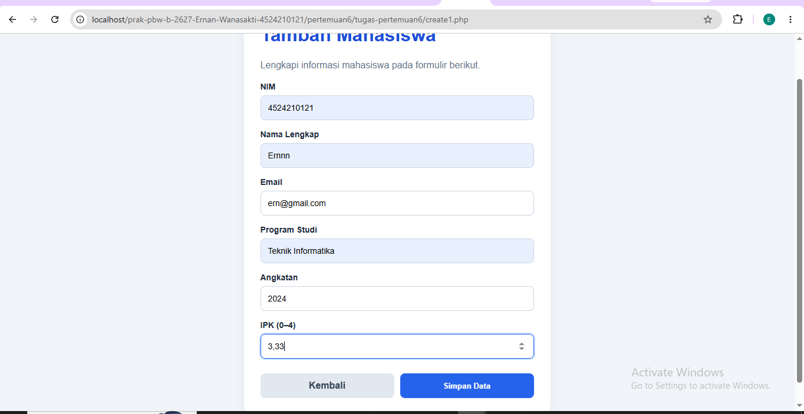
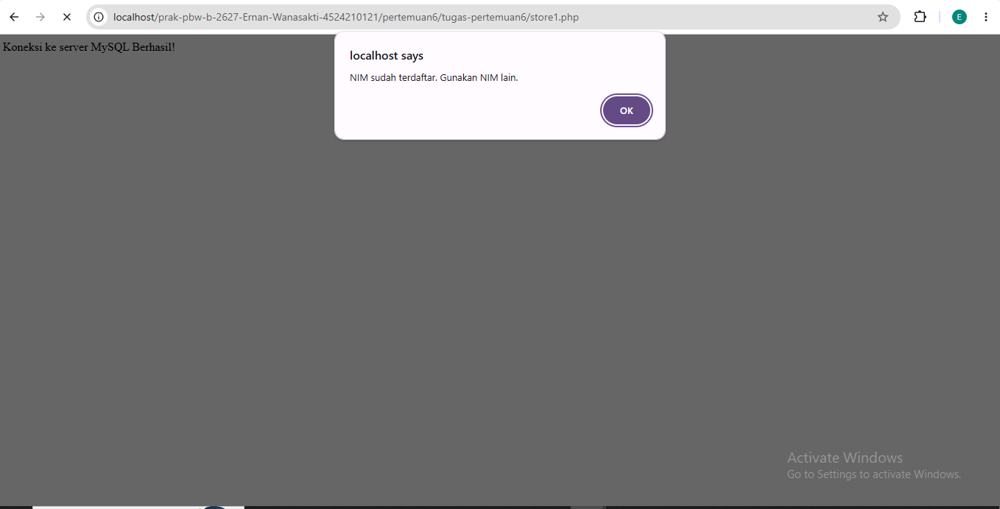
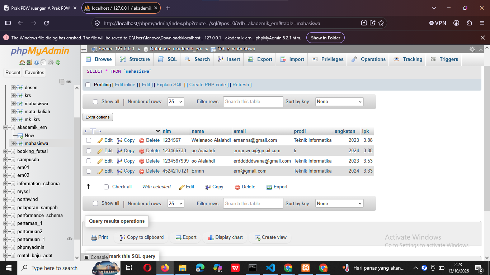

# LAPORAN TUGAS PERTEMUAN 6

## Praktikum Pemrograman Berbasis Web

**Nama:** Ernan Wanasakti  
**NIM:** 4524210121  
**Program Studi:** Teknik Informatika  
**Universitas:** Universitas Pancasila

---

## 1. Deskripsi Tugas

Pada tugas Pertemuan 6, dilakukan pengembangan program pengelolaan data mahasiswa menggunakan PHP dan MySQL dengan menerapkan konsep CRUD (_Create, Read, Update, Delete_).

Program terdiri dari beberapa file utama, yaitu `index1.php`, `create1.php`, `store1.php`, `edit1.php`, `update1.php`, `delete1.php`, dan `koneksi1.php`.

Modifikasi dilakukan dengan menambahkan fitur pencarian data mahasiswa, validasi input, pemeriksaan NIM duplikat, penggunaan prepared statement, perbaikan tampilan antarmuka, serta konfirmasi sebelum penghapusan data.

## 2. Struktur Folder

```text
tugas-pertemuan6/
├── index1.php
├── create1.php
├── store1.php
├── edit1.php
├── update1.php
├── delete1.php
├── koneksi1.php
├── README.md
└── screenshot/
    ├── halaman-utama.png
    ├── form-tambah.png
    ├── validasi-data.png
    └── data-database.png
```

## 3. Modifikasi Program

### A. Modifikasi pada index1.php

Modifikasi yang dilakukan pada file `index1.php` meliputi:

1. Memperbaiki tampilan halaman utama menggunakan CSS.
2. Menampilkan data mahasiswa dalam bentuk tabel.
3. Menambahkan fitur pencarian berdasarkan NIM, nama, atau program studi.
4. Menampilkan jumlah data mahasiswa.
5. Menambahkan tombol untuk menambah, mengubah, dan menghapus data.
6. Menggunakan prepared statement pada proses pencarian.
7. Menambahkan konfirmasi sebelum penghapusan data.

### B. Modifikasi pada create1.php dan store1.php

Modifikasi yang dilakukan meliputi:

1. Membuat formulir tambah data mahasiswa dengan tampilan yang lebih rapi.
2. Menyediakan kolom NIM, nama, email, program studi, angkatan, dan IPK.
3. Menambahkan validasi input untuk memeriksa kelengkapan dan format data.
4. Membatasi nilai IPK dari 0 sampai 4.
5. Memeriksa NIM sebelum menyimpan data untuk mencegah duplikasi.
6. Menggunakan prepared statement untuk proses penyimpanan.
7. Menampilkan pesan ketika data berhasil disimpan atau terjadi kegagalan.

### C. Modifikasi pada edit1.php dan update1.php

Modifikasi yang dilakukan meliputi:

1. Mengambil data mahasiswa berdasarkan NIM.
2. Menampilkan data lama pada formulir edit.
3. Memvalidasi data yang akan diperbarui.
4. Menggunakan prepared statement untuk mengambil dan memperbarui data.
5. Mengarahkan pengguna kembali ke halaman utama setelah proses perubahan selesai.

### D. Modifikasi pada delete1.php

Modifikasi yang dilakukan pada file `delete1.php` meliputi:

1. Menggunakan metode POST untuk mengirim permintaan penghapusan.
2. Mengambil NIM mahasiswa yang akan dihapus.
3. Menggunakan prepared statement pada query DELETE.
4. Menampilkan pesan hasil penghapusan.
5. Mengarahkan pengguna kembali ke halaman utama setelah proses selesai.

## 4. Lima Bagian Kode yang Penting

### 1. Pemanggilan Koneksi Database pada index1.php

```php
include "koneksi1.php";
```

Kode ini digunakan untuk memanggil file `koneksi1.php` agar halaman utama dapat terhubung dengan database MySQL. Koneksi tersebut diperlukan untuk mengambil dan mengelola data mahasiswa.

### 2. Query Pencarian Data pada index1.php

```php
$sql = "SELECT * FROM mahasiswa
        WHERE nim LIKE ?
        OR nama LIKE ?
        OR prodi LIKE ?";
```

Kode tersebut digunakan untuk mencari data mahasiswa berdasarkan NIM, nama, atau program studi. Parameter pencarian diberikan melalui prepared statement sehingga input pengguna tidak langsung digabungkan ke dalam query SQL.

### 3. Validasi Input pada store1.php

```php
if (
    $nim === '' || !ctype_digit($nim) ||
    $nama === '' ||
    !filter_var($email, FILTER_VALIDATE_EMAIL) ||
    $prodi === '' ||
    $ipk === false || $ipk === null ||
    $ipk < 0 || $ipk > 4
) {
    kembali("Data tidak valid. Periksa kembali isian form.");
}
```

Kode ini digunakan untuk memeriksa data sebelum disimpan. Pemeriksaan mencakup NIM, nama, email, program studi, dan rentang IPK. Jika data tidak memenuhi ketentuan, proses penyimpanan dihentikan dan pesan validasi ditampilkan.

### 4. Prepared Statement pada store1.php

```php
$stmt = mysqli_prepare(
    $koneksi,
    "INSERT INTO mahasiswa
    (nim, nama, email, prodi, angkatan, ipk)
    VALUES (?, ?, ?, ?, ?, ?)"
);
```

Kode tersebut menyiapkan query SQL untuk menambahkan data mahasiswa ke database. Tanda tanya digunakan sebagai parameter yang akan diisi dengan data dari formulir. Penggunaan prepared statement membantu mengurangi risiko SQL injection.

### 5. Proses Penghapusan Data pada delete1.php

```php
$stmt = mysqli_prepare(
    $koneksi,
    "DELETE FROM mahasiswa WHERE nim = ?"
);

mysqli_stmt_bind_param($stmt, "s", $nim);
mysqli_stmt_execute($stmt);
```

Kode ini digunakan untuk menghapus data mahasiswa berdasarkan NIM. Prepared statement memastikan nilai NIM dikirim sebagai parameter query. Proses penghapusan juga didukung konfirmasi pada halaman utama agar pengguna tidak menghapus data secara tidak sengaja.

## 5. Dokumentasi Screenshot

### A. Halaman Utama

Screenshot ini menunjukkan halaman utama aplikasi setelah modifikasi, termasuk tabel mahasiswa, fitur pencarian, jumlah data, dan tombol untuk menambah, mengubah, serta menghapus data.



### B. Form Tambah Mahasiswa

Screenshot ini menunjukkan formulir input mahasiswa yang digunakan untuk menambahkan data baru. Formulir terdiri dari kolom NIM, nama, email, program studi, angkatan, dan IPK.



### C. Validasi Data

Screenshot ini menunjukkan pesan validasi ketika pengguna mencoba menyimpan data dengan NIM yang sudah terdaftar. Validasi tersebut digunakan untuk mencegah duplikasi NIM pada database.



### D. Database Mahasiswa

Screenshot ini menunjukkan tabel `mahasiswa` pada phpMyAdmin yang menyimpan data mahasiswa. Dokumentasi ini menjadi bukti bahwa aplikasi terhubung dengan database MySQL.



## 6. Error atau Kendala yang Ditemui

### Penanganan NIM yang Sudah Terdaftar

**Kendala:**

Pada proses pengembangan, pernah muncul pesan `Duplicate entry ... for key 'PRIMARY'` ketika data mahasiswa disimpan menggunakan NIM yang sudah terdaftar.

**Penyebab:**

Kolom NIM pada tabel mahasiswa digunakan sebagai primary key sehingga setiap mahasiswa harus memiliki NIM yang berbeda.

**Langkah Penanganan:**

Program diperbaiki dengan menambahkan pemeriksaan NIM sebelum proses penyimpanan. Jika NIM sudah terdaftar, program menampilkan pesan bahwa NIM tersebut telah digunakan. Dengan demikian, pengguna dapat memasukkan NIM lain tanpa mengulangi kesalahan yang sama.

Setelah perbaikan dan pengujian, fitur CRUD dapat berjalan sesuai dengan fungsi yang diharapkan.

## 7. Kesimpulan

Melalui tugas Pertemuan 6, program pengelolaan data mahasiswa berhasil dikembangkan menggunakan PHP dan MySQL dengan menerapkan konsep CRUD.

Modifikasi yang dilakukan mencakup fitur pencarian, validasi input, pemeriksaan NIM duplikat, penggunaan prepared statement, perbaikan tampilan, dan konfirmasi penghapusan. Pengujian melalui localhost dan phpMyAdmin dilakukan untuk memastikan fungsi utama aplikasi berjalan sesuai dengan yang diharapkan.
