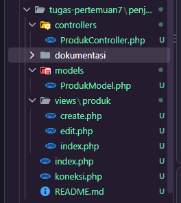
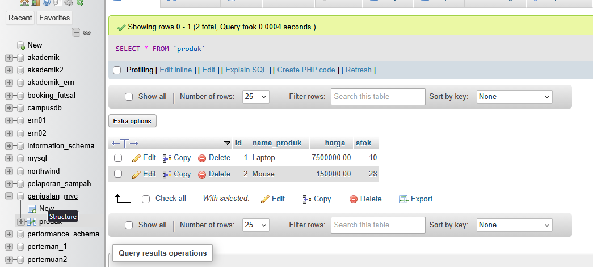
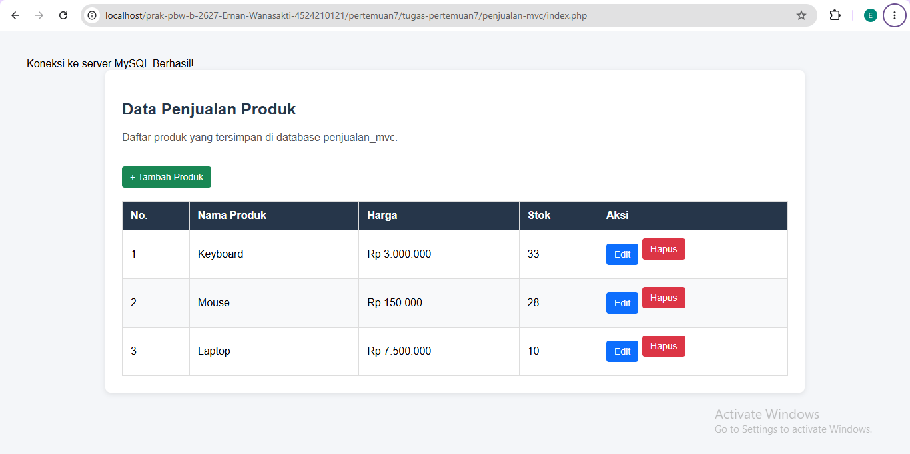
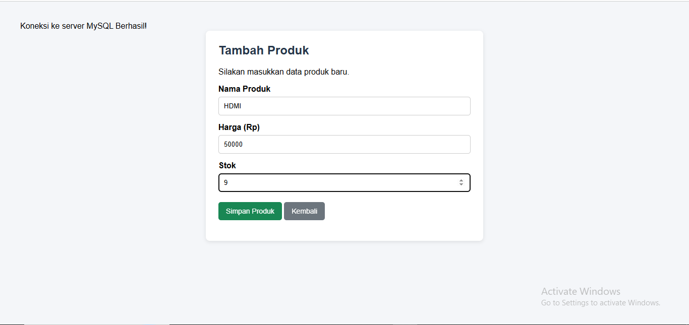
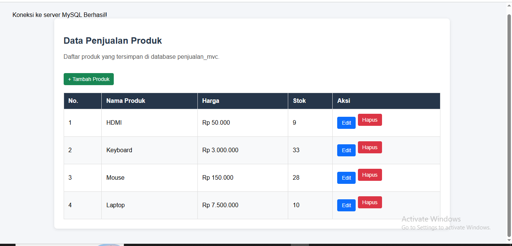

# LAPORAN TUGAS PERTEMUAN 7

# IMPLEMENTASI MODEL-VIEW-CONTROLLER (MVC) PADA PHP

## IDENTITAS MAHASISWA

- **Nama:** Ernan Wanasakti
- **NIM:** 4524210121
- **Program Studi:** Teknik Informatika
- **Mata Kuliah:** Pemrograman Berbasis Web
- **Topik:** Implementasi MVC pada Aplikasi Penjualan Produk

---

## 1. PENDAHULUAN

### 1.1 Latar Belakang

Dalam pengembangan aplikasi web, kode program perlu disusun dengan baik agar mudah dipahami, diperbaiki, dan dikembangkan. Salah satu pendekatan yang dapat digunakan adalah Model-View-Controller (MVC).

MVC merupakan pola arsitektur yang memisahkan aplikasi menjadi tiga bagian utama, yaitu Model, View, dan Controller. Setiap bagian memiliki tanggung jawab berbeda sehingga pengelolaan data, tampilan, dan alur aplikasi tidak tercampur dalam satu file.

Pada tugas ini, MVC diterapkan dalam aplikasi penjualan produk sederhana menggunakan PHP dan MySQL. Aplikasi menyediakan fitur untuk menampilkan, menambahkan, mengubah, dan menghapus data produk.

### 1.2 Tujuan

Tujuan pengerjaan tugas ini adalah:

1. Memahami konsep dasar arsitektur Model-View-Controller.
2. Mempraktikkan penggunaan PHP untuk membangun aplikasi web.
3. Menghubungkan aplikasi PHP dengan database MySQL.
4. Menerapkan operasi CRUD pada data produk.
5. Menyusun kode program ke dalam folder sesuai tanggung jawabnya.
6. Memahami alur komunikasi antara Model, View, dan Controller.

### 1.3 Ruang Lingkup

Aplikasi berfokus pada pengelolaan data produk dengan atribut:

- ID produk.
- Nama produk.
- Harga produk.
- Stok produk.

Aplikasi ini merupakan contoh penerapan MVC sederhana dan belum mencakup autentikasi pengguna, transaksi penjualan, maupun pengelolaan hak akses.

---

## 2. LANDASAN TEORI

### 2.1 PHP

PHP merupakan bahasa pemrograman yang dapat digunakan untuk membangun aplikasi web dinamis. Pada aplikasi ini, PHP digunakan untuk memproses permintaan pengguna, mengelola data produk, dan berkomunikasi dengan database MySQL.

### 2.2 MySQL

MySQL merupakan sistem manajemen basis data relasional yang digunakan untuk menyimpan dan mengelola data. Pada aplikasi ini, MySQL menyimpan informasi produk agar data dapat ditampilkan kembali setelah aplikasi diakses.

### 2.3 Model-View-Controller (MVC)

MVC adalah pola arsitektur aplikasi yang membagi tanggung jawab program menjadi tiga komponen.

**1. Model**

Model bertanggung jawab terhadap pengelolaan data dan komunikasi dengan database. Pada proyek ini, Model menangani pengambilan, penambahan, pengubahan, dan penghapusan data produk.

**2. View**

View merupakan bagian yang menampilkan informasi kepada pengguna. Pada proyek ini, View berupa halaman daftar produk, formulir tambah produk, dan formulir edit produk.

**3. Controller**

Controller mengatur alur aplikasi berdasarkan permintaan pengguna. Controller memanggil Model untuk memproses data dan menentukan View yang harus ditampilkan.

### 2.4 CRUD

CRUD adalah empat operasi dasar dalam pengelolaan data:

| Operasi | Arti             | Penerapan                 |
| ------- | ---------------- | ------------------------- |
| Create  | Membuat data     | Menambahkan produk        |
| Read    | Membaca data     | Menampilkan daftar produk |
| Update  | Memperbarui data | Mengubah informasi produk |
| Delete  | Menghapus data   | Menghapus produk          |

---

## 3. ANALISIS DAN PERANCANGAN SISTEM

### 3.1 Gambaran Umum Aplikasi

Aplikasi Penjualan Produk merupakan aplikasi web sederhana untuk mengelola daftar produk. Pengguna dapat membuka halaman utama untuk melihat produk, menambahkan produk baru, mengubah informasi produk yang sudah ada, serta menghapus produk yang tidak diperlukan.

Data yang dimasukkan pengguna diproses oleh Controller, diteruskan ke Model, lalu disimpan atau diambil dari database MySQL.

### 3.2 Struktur Folder Proyek

Struktur folder yang digunakan adalah sebagai berikut:

```text
penjualan-mvc/
├── controllers/
│   └── ProdukController.php
├── models/
│   └── ProdukModel.php
├── views/
│   └── produk/
│       ├── create.php
│       ├── edit.php
│       └── index.php
├── index.php
├── koneksi.php
└── README.md
```

Penjelasan setiap folder dan file:

| Folder/File                 | Fungsi                                                     |
| --------------------------- | ---------------------------------------------------------- |
| `controllers/`              | Menyimpan kode pengatur alur aplikasi                      |
| `ProdukController.php`      | Menangani permintaan dan menentukan proses yang dijalankan |
| `models/`                   | Menyimpan kode pengelolaan data                            |
| `ProdukModel.php`           | Menjalankan operasi database produk                        |
| `views/produk/`             | Menyimpan halaman antarmuka produk                         |
| `create.php`                | Formulir penambahan produk                                 |
| `edit.php`                  | Formulir perubahan produk                                  |
| `index.php` di dalam views  | Menampilkan daftar produk                                  |
| `koneksi.php`               | Menghubungkan aplikasi ke MySQL                            |
| `index.php` di folder utama | Menjadi pintu masuk aplikasi                               |

Struktur tersebut memisahkan bagian pengolahan data, tampilan, dan alur aplikasi agar lebih mudah dikelola.

### 3.3 Rancangan Alur Sistem

Alur umum aplikasi adalah:

1. Pengguna membuka aplikasi melalui browser.
2. File utama `index.php` memuat koneksi database dan Controller.
3. Controller membaca parameter aksi dari URL.
4. Controller memanggil fungsi yang sesuai pada Model.
5. Model mengambil atau mengubah data di database.
6. Controller menampilkan View yang sesuai atau mengarahkan pengguna kembali ke halaman utama.

Contoh alur penambahan produk:

```text
Pengguna
   |
   v
Form Tambah Produk
   |
   v
ProdukController.php
   |
   v
ProdukModel.php
   |
   v
Database MySQL
   |
   v
Kembali ke Daftar Produk
```

---

## 4. IMPLEMENTASI DATABASE

### 4.1 Pembuatan Database

Database dibuat menggunakan phpMyAdmin dengan nama `penjualan_mvc`.

Perintah SQL yang digunakan:

```sql
CREATE DATABASE penjualan_mvc;

USE penjualan_mvc;

CREATE TABLE produk (
    id INT AUTO_INCREMENT PRIMARY KEY,
    nama_produk VARCHAR(100) NOT NULL,
    harga DECIMAL(12,2) NOT NULL,
    stok INT NOT NULL
);
```

### 4.2 Penjelasan Struktur Tabel

| Kolom         | Tipe Data     | Fungsi                       |
| ------------- | ------------- | ---------------------------- |
| `id`          | INT           | Identitas unik setiap produk |
| `nama_produk` | VARCHAR(100)  | Menyimpan nama produk        |
| `harga`       | DECIMAL(12,2) | Menyimpan harga produk       |
| `stok`        | INT           | Menyimpan jumlah stok produk |

Kolom `id` digunakan sebagai primary key dan memiliki atribut `AUTO_INCREMENT`. Dengan demikian, ID akan bertambah secara otomatis ketika produk baru ditambahkan.

Kolom `nama_produk`, `harga`, dan `stok` menggunakan `NOT NULL` agar nilainya wajib diisi.

### 4.3 Koneksi Database

File `koneksi.php` digunakan untuk membuat koneksi antara PHP dan MySQL.

Contoh kode koneksi:

```php
<?php
$host = '127.0.0.1';
$user = 'root';
$password = '';
$dbname = 'penjualan_mvc';

$koneksi = mysqli_connect(
    $host,
    $user,
    $password,
    $dbname
);

if (!$koneksi) {
    die("Koneksi database gagal: " .
        mysqli_connect_error());
}

mysqli_set_charset($koneksi, "utf8mb4");
?>
```

**Penjelasan kode:**

- `$host` menentukan alamat server database.
- `$user` menentukan pengguna MySQL.
- `$password` berisi kata sandi MySQL.
- `$dbname` menentukan database yang digunakan.
- `mysqli_connect()` membuat koneksi ke database.
- `mysqli_connect_error()` memberikan informasi jika koneksi gagal.
- `mysqli_set_charset()` menetapkan karakter UTF-8 agar teks dapat disimpan dan dibaca dengan baik.

Konfigurasi di atas menggunakan pengaturan lokal XAMPP yang umum. Jika konfigurasi MySQL berbeda, nilai pengguna dan kata sandi perlu disesuaikan.

---

## 5. IMPLEMENTASI MODEL

### 5.1 Fungsi Model

File `models/ProdukModel.php` bertanggung jawab untuk menjalankan operasi database. Model tidak bertugas menampilkan halaman HTML, melainkan menyediakan fungsi yang dapat dipanggil oleh Controller.

Fungsi yang disediakan meliputi:

- `semua()` untuk mengambil seluruh data produk.
- `cari($id)` untuk mengambil produk berdasarkan ID.
- `tambah()` untuk menyimpan produk baru.
- `ubah()` untuk memperbarui produk.
- `hapus($id)` untuk menghapus produk berdasarkan ID.

### 5.2 Contoh Pengambilan Data

Contoh kode sederhana untuk mengambil data produk menggunakan prepared statement:

```php
public function semua()
{
    $sql = "SELECT * FROM produk ORDER BY id DESC";
    $stmt = mysqli_prepare($this->koneksi, $sql);

    mysqli_stmt_execute($stmt);
    $hasil = mysqli_stmt_get_result($stmt);

    return mysqli_fetch_all($hasil, MYSQLI_ASSOC);
}
```

**Penjelasan kode:**

1. `SELECT * FROM produk` digunakan untuk mengambil seluruh kolom dari tabel produk.
2. `ORDER BY id DESC` mengurutkan produk berdasarkan ID dari terbesar ke terkecil.
3. `mysqli_prepare()` menyiapkan perintah SQL.
4. `mysqli_stmt_execute()` menjalankan perintah SQL.
5. `mysqli_stmt_get_result()` mengambil hasil query.
6. `mysqli_fetch_all()` mengubah hasil query menjadi array asosiatif agar mudah digunakan oleh View.

Contoh tersebut merupakan gambaran salah satu fungsi Model. Implementasi lengkap berada pada file `ProdukModel.php`.

---

## 6. IMPLEMENTASI CONTROLLER

### 6.1 Fungsi Controller

File `controllers/ProdukController.php` bertanggung jawab mengatur alur aplikasi berdasarkan aksi pengguna.

Contoh aksi yang ditangani:

| Parameter Aksi | Fungsi                         |
| -------------- | ------------------------------ |
| `index`        | Menampilkan daftar produk      |
| `create`       | Membuka formulir tambah produk |
| `simpan`       | Menyimpan produk baru          |
| `edit`         | Membuka formulir edit produk   |
| `update`       | Memperbarui data produk        |
| `hapus`        | Menghapus produk               |

Parameter aksi dapat dibaca melalui URL menggunakan `$_GET`.

Contoh kode:

```php
$aksi = $_GET['aksi'] ?? 'index';
```

Kode tersebut berarti aplikasi akan menggunakan aksi `index` apabila parameter `aksi` tidak tersedia di URL.

Contoh alamat untuk membuka formulir tambah produk:

```text
index.php?aksi=create
```

Contoh alamat untuk mengedit produk dengan ID 1:

```text
index.php?aksi=edit&id=1
```

### 6.2 Proses Penambahan Produk

Ketika pengguna mengirim formulir tambah produk, Controller menerima data melalui `$_POST`, memeriksa nilai yang dimasukkan, kemudian memanggil fungsi Model untuk menyimpan produk.

Setelah proses berhasil, pengguna diarahkan kembali ke halaman daftar produk.

Pemisahan proses tersebut membuat Controller berfokus pada alur aplikasi, sedangkan proses komunikasi database dilakukan oleh Model.

---

## 7. IMPLEMENTASI VIEW

### 7.1 Halaman Daftar Produk

File `views/produk/index.php` menampilkan daftar produk yang diperoleh dari Controller.

Informasi yang ditampilkan meliputi:

- ID produk.
- Nama produk.
- Harga produk.
- Stok produk.
- Tombol untuk mengedit dan menghapus produk.

Halaman ini juga menyediakan tautan untuk membuka formulir penambahan produk.

### 7.2 Formulir Tambah Produk

File `views/produk/create.php` berisi formulir untuk memasukkan nama produk, harga, dan stok.

Contoh elemen formulir:

```html
<form action="index.php?aksi=simpan" method="POST">
  <label>Nama Produk</label>
  <input type="text" name="nama_produk" required />

  <label>Harga</label>
  <input type="number" name="harga" min="0" step="0.01" required />

  <label>Stok</label>
  <input type="number" name="stok" min="0" required />

  <button type="submit">Simpan</button>
</form>
```

**Penjelasan kode:**

- `action` menentukan alamat tujuan pengiriman data.
- `method="POST"` mengirim data formulir melalui metode POST.
- `name` menjadi nama variabel yang dibaca oleh PHP.
- `required` mewajibkan kolom diisi sebelum formulir dikirim.
- `min="0"` membatasi nilai agar tidak kurang dari nol pada formulir.
- `step="0.01"` memungkinkan harga memiliki dua angka desimal.

Validasi di browser membantu pengguna mengisi formulir, tetapi Controller tetap perlu melakukan validasi karena data yang dikirim dapat dimanipulasi.

### 7.3 Formulir Edit Produk

File `views/produk/edit.php` menampilkan formulir yang sudah berisi data produk sebelumnya.

Formulir mengirimkan ID produk bersama data yang diperbarui. ID digunakan oleh Model untuk menentukan baris yang akan diubah.

Dengan begitu, pengguna dapat memperbarui informasi produk tanpa membuat baris data baru.

---

## 8. IMPLEMENTASI FITUR CRUD

### 8.1 Create — Menambahkan Produk

Fitur Create digunakan untuk menambahkan data produk baru.

Langkah kerja:

1. Pengguna membuka formulir tambah produk.
2. Pengguna memasukkan nama, harga, dan stok.
3. Formulir mengirim data ke Controller menggunakan POST.
4. Controller memvalidasi data.
5. Model menyimpan data ke tabel `produk`.
6. Aplikasi kembali ke halaman daftar produk.

### 8.2 Read — Menampilkan Produk

Fitur Read digunakan untuk membaca data yang tersimpan dalam database.

Model mengambil data produk, kemudian Controller meneruskan hasilnya ke View. View menampilkan data tersebut dalam bentuk tabel agar mudah dibaca pengguna.

### 8.3 Update — Mengubah Produk

Fitur Update digunakan untuk memperbarui informasi produk.

Pengguna memilih tombol edit, kemudian aplikasi mengambil data berdasarkan ID. Setelah formulir dikirim, Controller memproses perubahan melalui Model dan database diperbarui.

### 8.4 Delete — Menghapus Produk

Fitur Delete digunakan untuk menghapus produk berdasarkan ID.

Pada aplikasi ini, penghapusan dilakukan melalui formulir POST yang mengirim ID produk ke Controller. Model kemudian menjalankan perintah penghapusan terhadap data yang sesuai.

Penggunaan POST untuk operasi penghapusan lebih tepat dibandingkan menggunakan tautan GET karena penghapusan merupakan tindakan yang mengubah data.

---

## 9. FILE UTAMA APLIKASI

File `index.php` pada folder utama menjadi pintu masuk aplikasi.

Contoh kode:

```php
<?php
require_once __DIR__ . '/koneksi.php';
require_once __DIR__ . '/controllers/ProdukController.php';

$controller = new ProdukController($koneksi);
$controller->jalankan();
?>
```

**Penjelasan kode:**

- `require_once` memuat file yang dibutuhkan satu kali.
- `__DIR__` mengacu pada direktori tempat file utama berada.
- `ProdukController` dibuat dengan memberikan koneksi database.
- `jalankan()` menjalankan proses sesuai aksi yang diminta pengguna.

Dengan pendekatan ini, pengguna cukup membuka file utama untuk mengakses aplikasi.

---

## 10. PENGUJIAN APLIKASI

Pengujian dilakukan untuk memastikan setiap fitur utama berjalan sesuai fungsinya.

| No. | Skenario Pengujian                          | Hasil yang Diharapkan                            |
| --- | ------------------------------------------- | ------------------------------------------------ |
| 1   | Membuka halaman utama                       | Daftar produk tampil                             |
| 2   | Membuka formulir tambah                     | Formulir tambah produk tampil                    |
| 3   | Menambahkan produk valid                    | Produk tersimpan dan muncul di daftar            |
| 4   | Membuka formulir edit                       | Data produk sebelumnya tampil                    |
| 5   | Mengubah data produk                        | Perubahan tersimpan                              |
| 6   | Menghapus produk                            | Produk terhapus dari daftar                      |
| 7   | Mengirim formulir dengan kolom wajib kosong | Formulir dicegah atau data ditolak oleh validasi |

**Catatan:** hasil pengujian akhir harus disesuaikan dengan pengujian yang benar-benar dilakukan. Jangan menandai semua skenario berhasil sebelum mencobanya di browser.

---

## 11. DOKUMENTASI SCREENSHOT

**Catatan dokumentasi:** Screenshot akan dimasukkan setelah aplikasi dijalankan dan pengujian dilakukan. Gunakan gambar asli dari Visual Studio Code, phpMyAdmin, dan browser. Setiap gambar dilengkapi keterangan singkat.

### 11.1 Screenshot Struktur Folder MVC

**Tujuan:** menunjukkan susunan folder dan file aplikasi sesuai konsep MVC.

**Gambar 1 — Struktur Folder Proyek**



### 11.2 Screenshot Database MySQL

**Tujuan:** membuktikan bahwa database `penjualan_mvc` dan tabel `produk` telah dibuat.

**Gambar 2 — Database dan Tabel Produk**



### 11.3 Screenshot Halaman Daftar Produk

**Tujuan:** menunjukkan tampilan utama aplikasi dan data produk yang berhasil dibaca dari database.

**Gambar 3 — Halaman Daftar Produk**



### 11.4 Screenshot Formulir Tambah atau Edit Produk

**Tujuan:** membuktikan bahwa pengguna dapat membuka formulir untuk memasukkan atau mengubah data produk.

**Gambar 4 — Formulir Produk**



### 11.5 Screenshot Pengujian CRUD

**Tujuan:** menunjukkan hasil pengujian penambahan, pengubahan, dan penghapusan produk.

**Gambar 5 — Hasil Pengujian CRUD**


